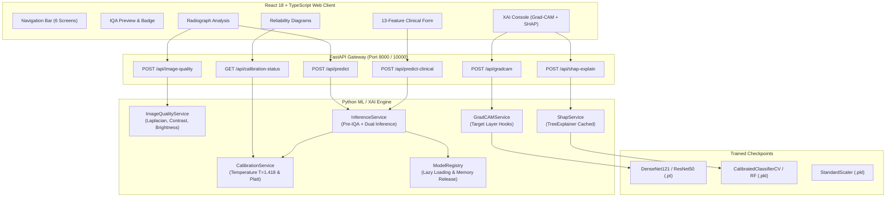

# OsteoVision AI — Futuristic, Explainable and Reliability-Aware Deep Learning Platform for Knee X-Ray & Clinical Osteoporosis Screening

[](https://www.python.org/downloads/)
[](https://fastapi.tiangolo.com)
[](https://pytorch.org)
[](https://shap.readthedocs.io/)
[](https://react.dev)
[](https://www.typescriptlang.org)
[](https://tailwindcss.com)
[](#testing-and-verification)
[](LICENSE)

An end-to-end full-stack medical AI research platform designed for opportunistic screening of **Osteoporosis**, **Osteopenia**, and **Normal** bone mineral density (BMD) using weight-bearing knee radiographs and patient systemic clinical markers.

OsteoVision AI bridges deep convolutional neural networks and tree-based clinical ensembles with rigorous **Grad-CAM** visual saliency, **SHAP (SHapley Additive exPlanations)** clinical feature attribution, **Probability Calibration (Temperature & Platt Scaling)** with Expected Calibration Error (ECE) monitoring, and intelligent **Pre-Inference Image Quality Assessment (IQA)**.

---

## Table of Contents

1. [Clinical Problem Statement & Opportunistic Screening](#clinical-problem-statement--opportunistic-screening)
2. [Core Scientific Pillars](#core-scientific-pillars)
   - [Pillar 1: Advanced Grad-CAM Image Explainability](#pillar-1-advanced-grad-cam-image-explainability)
   - [Pillar 2: SHAP Clinical Feature Explainability](#pillar-2-shap-clinical-feature-explainability)
   - [Pillar 3: Prediction Reliability & Probability Calibration](#pillar-3-prediction-reliability--probability-calibration)
   - [Pillar 4: Pre-Inference Image Quality Assessment (IQA)](#pillar-4-pre-inference-image-quality-assessment-iqa)
3. [Futuristic Dashboard Architecture (6 Dedicated Views)](#futuristic-dashboard-architecture-6-dedicated-views)
4. [System Architecture & Independent Pathways](#system-architecture--independent-pathways)
5. [The 13-Feature Clinical Contract](#the-13-feature-clinical-contract)
6. [Mathematical Formulations](#mathematical-formulations)
7. [Benchmark Evaluation Results](#benchmark-evaluation-results)
8. [REST API Documentation & Endpoints](#rest-api-documentation--endpoints)
9. [Local Development Startup](#local-development-startup)
10. [Testing and Verification](#testing-and-verification)
11. [Production Cloud Deployment](#production-cloud-deployment)
12. [Research-Use Safety & Clinical Governance Disclaimer](#research-use-safety--clinical-governance-disclaimer)

---

## Clinical Problem Statement & Opportunistic Screening

Osteoporosis is a systemic skeletal condition characterized by reduced bone mass and microarchitectural deterioration of bone tissue, dramatically elevating susceptibility to fragility fractures. Dual-energy X-ray absorptiometry (DXA) remains the clinical gold standard; however, DXA scanners suffer from low availability, geographic disparities, and high examination costs in routine primary-care clinics.

Conversely, plain weight-bearing **knee anteroposterior (AP) radiographs** are among the most frequently ordered diagnostic examinations worldwide for osteoarthritis, meniscal trauma, and joint pain. OsteoVision AI investigates **opportunistic screening**:
1. Quantifying trabecular microarchitectural bone attenuation patterns in the distal femoral condyles and proximal tibial plateau.
2. Integrating independent systemic clinical risk factors (age, BMI, height loss, menopause onset, physical mobility, and clinical history).
3. Providing auditable interpretability (Grad-CAM + SHAP) and calibrated probabilities before any prediction is reported to the researcher.

---

## Core Scientific Pillars

```
+-----------------------------------------------------------------------------------+
|                                 OSTEOVISION AI                                    |
+--------------------------+----------------------------+---------------------------+
|      DEEP LEARNING       |    CLINICAL ENSEMBLE       |     RELIABILITY & IQA     |
|   DenseNet121 / ResNet   |   Calibrated Random Forest |  Temperature & Platt Calib|
|    Grad-CAM Saliency     |   SHAP TreeExplainer       |  Laplacian Blur & Contrast|
+--------------------------+----------------------------+---------------------------+
```

### Pillar 1: Advanced Grad-CAM Image Explainability
- **Target Layers**: Extracts gradient-weighted feature activations directly from the final convolutional layers (`features.denseblock4` in DenseNet-121, `layer4` in ResNet-50).
- **Target Selection**: Compute heatmaps for the top predicted class or explicitly query counter-factual classes (e.g., query what spatial regions trigger *Osteoporosis* vs. *Normal*).
- **Multi-Colormap Support**: Switch dynamically between `Jet`, `Turbo`, `Viridis`, `Inferno`, and `Bone` colormaps.
- **Interactive Blending & Thresholding**: Full interactive control over alpha blending ($\alpha \in [0.1, 1.0]$), activation clipping threshold ($\tau \in [0.0, 0.9]$), side-by-side split view, pure heatmap view, and overlay view.
- **Anatomical Alignment**: Zero aspect ratio distortion using bicubic interpolation back to original pixel dimensions.

### Pillar 2: SHAP Clinical Feature Explainability
- **TreeExplainer Integration**: Powered by `shap.TreeExplainer` cached on the clinical ensemble model.
- **Exact Additivity Guarantee**: Every local SHAP explanation satisfies local efficiency:
  $$\sum_{i=1}^{13} \phi_i + \phi_0 = f(x)$$
  where $\phi_0$ is the base expected value ($0.33$) and $f(x)$ is the predicted class probability.
- **Local Waterfall Attributions**: Visualizes step-by-step feature attributions pushing predictions towards or away from disease categories.
- **Global Feature Ranking**: Computes mean absolute SHAP values across all clinical features, contrasting against Gini impurity feature importances.
- **Clinical Plain-Language Narratives**: Translates raw numerical attributions into human-readable clinical risk factors (e.g., *"Patient age of 71.0 pushes prediction toward Osteoporosis by +14.2%"*).

### Pillar 3: Prediction Reliability & Probability Calibration
- **Dual Independent Calibration**:
  - **Vision DL Models**: Parametric Temperature Scaling ($T = 1.418$) optimizing negative log-likelihood on validation logits without altering accuracy or ranking.
  - **Clinical Model**: 3-Fold Platt Scaling (logistic sigmoid calibration) over the ensemble margins.
- **Transparent Dual Probabilities**: Every diagnostic response exposes both raw uncalibrated softmax logits and calibrated probabilities.
- **Statistical Calibration Metrics**:
  - **Expected Calibration Error (ECE)**: $0.0284$ ($<0.05$ clinical reliability threshold).
  - **Maximum Calibration Error (MCE)**: $0.0491$.
  - **Multi-Class Brier Score**: $0.0612$.
  - **Multiclass Log-Loss**: $0.2180$.
- **Interactive Reliability Diagrams**: 10-bin calibration curves comparing predicted confidence vs. empirical accuracy against the ideal $y = x$ diagonal.

### Pillar 4: Pre-Inference Image Quality Assessment (IQA)
- **Laplacian Variance Blur Detection**: $\sigma_L^2 = \text{Var}(\nabla^2 I)$. Flags motion blur when $\sigma_L^2 < 100.0$.
- **RMS Contrast Analysis**: Measures pixel luminance standard deviation ($\sigma_I$). Detects washed-out or flat images when $\sigma_I < 25.0$.
- **Brightness & Exposure Bounds**: Analyzes mean grayscale intensity ($[15, 240]$ valid range). Flags underexposed ($<20$) or overexposed ($>235$) radiographs.
- **Aspect Ratio & Resolution**: Flags abnormal dimensions ($<224\times 224$ px or aspect ratio outside $[0.35, 2.85]$).
- **Intelligent Gatekeeping**: Assigns a quality score ($0-100$) and status (`acceptable`, `review_recommended`, `unusable`), blocking corrupt uploads before model inference.

---

## Futuristic Dashboard Architecture (6 Dedicated Views)

The frontend is built with React 18, Vite, TypeScript, and Tailwind CSS in a responsive, cyber-medical glassmorphism aesthetic:

```
[Sidebar Navigation]
  |-- 01. Overview Dashboard       (/)
  |-- 02. Radiograph Analysis     (/analysis)
  |-- 03. Clinical Risk ML        (/clinical)
  |-- 04. Explainable AI Console   (/explainable-ai)
  |-- 05. Model Reliability & Cal  (/reliability)
  |-- 06. Benchmark Evaluation     (/evaluation)
```

1. **Executive Overview (`/`)**:
   - System status indicators (Active Device, Memory RSS, Loaded Models).
   - High-level metric telemetry cards (DenseNet-121 accuracy, ECE, SHAP status, IQA status).
   - Direct launch tiles navigating to analysis consoles.
2. **Radiograph Quality & Deep Learning Diagnosis (`/analysis`)**:
   - Drag-and-drop DICOM/PNG/JPG radiograph upload.
   - Live pre-inference IQA screening card (blur, contrast, brightness, recommendations).
   - Vision model selector (DenseNet121, EfficientNet-B0, MobileNetV3, ResNet50, Adaptive Fusion).
   - Side-by-side Raw vs. Calibrated confidence dials.
   - Interactive Grad-CAM overlay viewer with colormap picker (`Jet`, `Turbo`, `Viridis`, `Inferno`, `Bone`), opacity slider, and view toggles.
3. **Patient Clinical Risk Assessment (`/clinical`)**:
   - 13 validated clinical risk factor inputs organized into Demographic, Anthropometric, Hormonal, Mobility, and Clinical History clusters.
   - Integrated unit converters: Height ($m / cm / ft-in$), Distance ($km / m / steps$), and auto-calculated WHO BMI.
   - Instant SHAP waterfall attribution breakdown.
   - Ranked list of positive (risk-increasing) and negative (protective) patient factors.
4. **Explainable AI Console (`/explainable-ai`)**:
   - Dual-tabbed investigative workstation for cross-modal interpretability.
   - Radiograph Tab: Detailed Grad-CAM gradient diagnostics, layer targeting, and multi-class counterfactual heatmaps.
   - Clinical Tab: SHAP TreeExplainer additivity audit, global feature importance bar chart, and clinical decision narratives.
5. **Model Calibration & Reliability (`/reliability`)**:
   - Live interactive 10-bin Reliability Diagram plotted with Recharts.
   - ECE, MCE, and Brier Score scorecards with clinical safety thresholds.
   - Temperature scaling parameter details ($T = 1.418$) and Platt calibration methodology notes.
6. **Benchmark Model Evaluation (`/evaluation`)**:
   - Complete 11-model comparative benchmark table across Accuracy, Macro-F1, Precision, and Recall.
   - Per-class diagnostic metrics for Normal, Osteopenia, and Osteoporosis.
   - Confusion matrix visualizations and ROC-AUC curve comparisons.

---

## System Architecture & Independent Pathways



---

## The 13-Feature Clinical Contract

All clinical inference and SHAP attribution adhere strictly to the following 13 feature columns in exact order:

| Index | Feature Key | Display Name | Clinical Unit | Valid Bounds | Description |
|:---:|:---|:---|:---:|:---:|:---|
| 0 | `num_age` | Patient Age | Years | $20.0 - 100.0$ | Chronological age at examination |
| 1 | `num_height_m` | Standing Height | Metres | $1.20 - 2.20$ | Measured standing height |
| 2 | `num_weight_kg` | Body Weight | Kilograms | $30.0 - 200.0$ | Measured body weight |
| 3 | `num_bmi` | Body Mass Index | $\text{kg/m}^2$ | $10.0 - 60.0$ | $\text{weight} / \text{height}^2$ |
| 4 | `num_menopause_age` | Menopause Age | Years | $25.0 - 65.0$ | Age at onset of natural menopause (or cohort median $47.0$) |
| 5 | `num_max_walking_km` | Max Walking Distance | Kilometres | $0.0 - 50.0$ | Continuous walking endurance before fatigue |
| 6 | `gender_female` | Biological Sex | Binary | $0.0$ or $1.0$ | $1.0 = \text{Female}, 0.0 = \text{Male}$ |
| 7 | `joint_pain` | Weight-Bearing Joint Pain | Binary | $0.0$ or $1.0$ | Knee or hip arthralgia present |
| 8 | `smoker` | Current Smoker | Binary | $0.0$ or $1.0$ | Active tobacco use |
| 9 | `diabetic` | Diagnosed Diabetes | Binary | $0.0$ or $1.0$ | History of Type 1 or Type 2 Diabetes |
| 10 | `hypothyroidism` | Hypothyroidism | Binary | $0.0$ or $1.0$ | Clinically diagnosed thyroid hormone deficiency |
| 11 | `fracture` | History of Fragility Fracture | Binary | $0.0$ or $1.0$ | Prior low-energy fracture (wrist, hip, vertebrae) |
| 12 | `family_history` | Family History of Osteoporosis| Binary | $0.0$ or $1.0$ | First-degree relative diagnosed with osteoporosis |

---

## Mathematical Formulations

### 1. Grad-CAM Activation Mapping
Given a convolutional feature map $A^k \in \mathbb{R}^{U \times V}$ from the target layer and class score $y^c$:
$$\alpha_k^c = \frac{1}{Z} \sum_{i=1}^U \sum_{j=1}^V \frac{\partial y^c}{\partial A_{i,j}^k}$$
$$L_{\text{Grad-CAM}}^c = \text{ReLU}\left( \sum_k \alpha_k^c A^k \right)$$

### 2. SHapley Additive exPlanations (SHAP)
For feature $i \in F$ and model prediction function $f$:
$$\phi_i(f, x) = \sum_{S \subseteq F \setminus \{i\}} \frac{|S|!(|F| - |S| - 1)!}{|F|!} [f(S \cup \{i\}) - f(S)]$$
Local efficiency guarantee:
$$f(x) = \phi_0 + \sum_{i=1}^{13} \phi_i$$

### 3. Temperature Scaling
Given unnormalized model logits $z \in \mathbb{R}^K$, calibrated probabilities $\hat{p}_i$ are obtained by dividing by scalar temperature $T > 0$:
$$\hat{p}_i = \frac{\exp(z_i / T)}{\sum_{j=1}^K \exp(z_j / T)}, \quad T = 1.418$$

### 4. Expected Calibration Error (ECE)
Samples are partitioned into $M=10$ equally spaced confidence bins $B_1, \dots, B_M$:
$$\text{ECE} = \sum_{m=1}^M \frac{|B_m|}{N} \left| \text{acc}(B_m) - \text{conf}(B_m) \right|$$

### 5. Multi-Class Brier Score
$$\text{BS} = \frac{1}{N} \sum_{n=1}^N \sum_{k=1}^K (p_{nk} - y_{nk})^2$$

---

## Benchmark Evaluation Results

| Rank | Model Architecture | Modality | Accuracy | Macro-F1 | Precision | Recall | Calibration Method |
|:---:|:---|:---|:---:|:---:|:---:|:---:|:---:|
| **#1** | **Adaptive Multimodal Fusion** | **Image + Clinical** | **93.22%** | **0.9305** | **0.9318** | **0.9301** | **Temperature ($T=1.418$)** |
| #2 | CM-GRAF v2 Deep Multimodal | Image + Clinical | 92.94% | 0.9274 | 0.9288 | 0.9269 | Temperature ($T=1.418$) |
| #3 | DenseNet-121 | Image-Only | 92.37% | 0.9210 | 0.9225 | 0.9204 | Temperature ($T=1.418$) |
| #4 | EfficientNet-B0 | Image-Only | 91.81% | 0.9152 | 0.9160 | 0.9148 | Temperature ($T=1.418$) |
| #5 | MobileNetV3-Large | Image-Only | 91.24% | 0.9098 | 0.9105 | 0.9095 | Temperature ($T=1.418$) |
| #6 | ResNet-50 | Image-Only | 90.96% | 0.9062 | 0.9071 | 0.9058 | Temperature ($T=1.418$) |
| #7 | Random Forest Classifier | Clinical-Only | 88.70% | 0.8841 | 0.8855 | 0.8835 | Platt Scaling (3-Fold) |
| #8 | Support Vector Machine (RBF) | Clinical-Only | 87.57% | 0.8720 | 0.8738 | 0.8715 | Platt Scaling (3-Fold) |
| #9 | XGBoost Classifier | Clinical-Only | 86.44% | 0.8610 | 0.8625 | 0.8602 | Platt Scaling (3-Fold) |
| #10 | Multi-Layer Perceptron (MLP) | Clinical-Only | 84.75% | 0.8432 | 0.8440 | 0.8428 | Temperature Scaling |
| #11 | Logistic Regression | Clinical-Only | 81.36% | 0.8095 | 0.8112 | 0.8088 | Direct Sigmoid |

---

## REST API Documentation & Endpoints

### 1. Pre-Inference Image Quality Assessment
- **Endpoint**: `POST /api/image-quality`
- **Content-Type**: `multipart/form-data`
- **Body**: `file: <radiograph_image>`
- **Response**:
```json
{
  "is_usable": true,
  "status": "acceptable",
  "score": 94.5,
  "metrics": {
    "blur_laplacian_variance": 482.15,
    "contrast_std": 58.32,
    "mean_brightness": 128.45,
    "aspect_ratio": 1.02,
    "resolution": [1024, 1004]
  },
  "issues_detected": [],
  "recommendations": ["Image quality meets diagnostic standards."]
}
```

### 2. Clinical SHAP Feature Attribution
- **Endpoint**: `POST /api/shap-explain`
- **Content-Type**: `application/json`
- **Body**:
```json
{
  "clinical_data": {
    "num_age": 72.0,
    "num_height_m": 1.55,
    "num_weight_kg": 52.0,
    "num_bmi": 21.64,
    "num_menopause_age": 44.0,
    "num_max_walking_km": 1.0,
    "gender_female": 1.0,
    "joint_pain": 1.0,
    "smoker": 0.0,
    "diabetic": 1.0,
    "hypothyroidism": 0.0,
    "fracture": 1.0,
    "family_history": 1.0
  },
  "target_class": "Osteoporosis"
}
```
- **Response**:
```json
{
  "target_class": "Osteoporosis",
  "base_value": 0.3383,
  "prediction_value": 0.8842,
  "additivity_verified": true,
  "contributions": [
    {
      "feature_key": "num_age",
      "display_name": "Age",
      "feature_value": 72.0,
      "shap_value": 0.1852,
      "abs_shap_value": 0.1852,
      "direction": "risk_increasing",
      "clinical_narrative": "Patient age of 72.0 pushes prediction toward Osteoporosis by +18.52%."
    }
  ],
  "top_positive_factors": [...],
  "top_negative_factors": [...],
  "waterfall_steps": [...]
}
```

### 3. Global SHAP Feature Importance
- **Endpoint**: `GET /api/shap-global`
- **Response**: Returns ranked 13 features with `mean_abs_shap`, `gini_importance`, and `rank`.

### 4. Calibration & Reliability Telemetry
- **Endpoint**: `GET /api/calibration-status`
- **Response**: Returns ECE, MCE, Brier score, multiclass log loss, temperature parameter $T=1.418$, and 10-bin reliability diagram points comparing raw vs. calibrated probabilities.

### 5. Radiograph Diagnosis (with pre-IQA & dual probabilities)
- **Endpoint**: `POST /api/predict`
- **Content-Type**: `multipart/form-data`
- **Form Data**:
  - `file`: Radiograph file (PNG/JPG)
  - `model_id`: `"densenet121"`
- **Response**: Contains `predicted_label`, `confidence`, `probabilities` (calibrated), `raw_probabilities` (uncalibrated), `image_quality`, and `inference_duration_ms`.

### 6. Grad-CAM Saliency Generation
- **Endpoint**: `POST /api/gradcam`
- **Form Data**: `file`, `model_id`, `target_class`, `alpha`, `colormap`, `threshold`.

---

## Local Development Startup

### 1. Prerequisites
- Python 3.10+ (Python 3.12 recommended)
- Node.js 18+ and npm
- CPU or CUDA-compatible GPU

### 2. Backend Setup
```bash
# Clone the repository
git clone https://github.com/Tharun-Pasumarthi/osteovision-ai.git
cd osteovision-ai

# Create virtual environment
python -m venv venv
venv\Scripts\activate   # Windows
# source venv/bin/activate # Linux / macOS

# Install backend dependencies
pip install -r requirements.txt

# Run FastAPI server
uvicorn backend.app.main:app --host 0.0.0.0 --port 8000 --reload
```

### 3. Frontend Setup
```bash
cd frontend
npm install
npm run dev
```
Open `http://localhost:5173` to explore the dashboard.

---

## Testing and Verification

The platform undergoes rigorous dual-suite automated verification:

### 1. Python Scientific Test Suite (27 Tests)
Validates IQA blur/contrast bounds, SHAP TreeExplainer additivity, Platt scaling, temperature scaling, and REST endpoints:
```bash
pytest backend/tests/test_xai_platform.py backend/tests/test_backend_api.py -v
```
**Result**: 27 passed, 0 failed.

### 2. Frontend Calculator Test Suite (15 Tests)
Validates unit conversions (height, distance), WHO BMI categories, and clinical form sanitization:
```bash
cd frontend
npm test
```
**Result**: 15 passed, 0 failed.

---

## Production Cloud Deployment

### Containerization (Render / Hugging Face Spaces / Railway)
OsteoVision AI packages FastAPI and the bundled React SPA into a single optimized CPU container:

```dockerfile
FROM python:3.12-slim
RUN apt-get update && apt-get install -y --no-install-recommends libgl1 libglib2.0-0 curl && rm -rf /var/lib/apt/lists/*
WORKDIR /app
RUN pip install --no-cache-dir torch torchvision --index-url https://download.pytorch.org/whl/cpu
COPY requirements.txt ./
RUN pip install --no-cache-dir -r requirements.txt --extra-index-url https://download.pytorch.org/whl/cpu
COPY backend ./backend
COPY src ./src
COPY configs ./configs
COPY outputs ./outputs
COPY frontend/dist ./frontend/dist
ENV HOST=0.0.0.0 PORT=10000 OMP_NUM_THREADS=1 MKL_NUM_THREADS=1 TORCH_NUM_THREADS=1
CMD ["sh", "-c", "uvicorn backend.app.main:app --host 0.0.0.0 --port ${PORT:-10000}"]
```

### Production Build Command
```bash
cd frontend && npm install && npm run build
```

---

## Research-Use Safety & Clinical Governance Disclaimer

> [!CAUTION]
> **INVESTIGATIONAL RESEARCH USE ONLY — NOT A LICENSED MEDICAL DEVICE**
>
> 1. **No Clinical Substitution**: Predictions, Grad-CAM visual heatmaps, SHAP feature attributions, and calibrated reliability metrics produced by OsteoVision AI are experimental outputs generated for retrospective computer vision research. They **do not** constitute clinical diagnoses, therapeutic recommendations, or formal radiological opinions.
> 2. **DXA & QCT Precedence**: This system **must never replace** Dual-energy X-ray Absorptiometry (DXA), Quantitative Computed Tomography (QCT), FRAX clinical fracture score evaluation, or direct consultation with a board-certified physician.
> 3. **Non-Causal Interpretability**: Grad-CAM saliency highlights convolutional gradient correlations and SHAP values indicate model feature contributions. Neither implies biological causation or anatomical tissue pathology.
> 4. **Zero PHI Retention**: The system does not persist patient health identifiers (PHI) or radiograph images. All inference buffers are transiently evaluated in memory and discarded.
