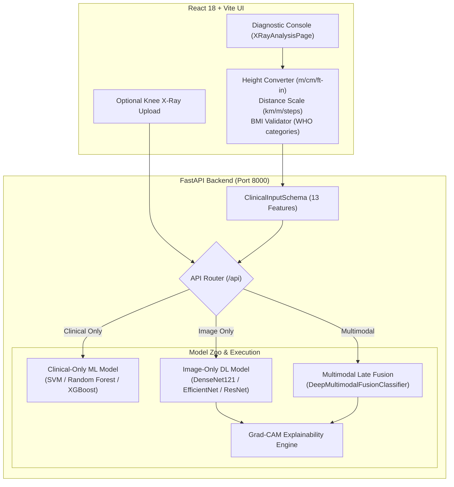

# Deep Learning-Based Knee X-Ray Classification for Osteoporosis Screening with Explainable AI

[](https://www.python.org/downloads/)
[](https://fastapi.tiangolo.com)
[](https://pytorch.org)
[](https://react.dev)
[](https://www.typescriptlang.org)
[](https://tailwindcss.com)
[](#testing-and-verification)

An end-to-end full-stack medical research platform for opportunistic screening of **Osteoporosis**, **Osteopenia**, and **Normal** bone mineral density from knee radiographs and patient systemic clinical markers.

---

## Table of Contents

1. [Clinical Problem Statement & Intended Use](#clinical-problem-statement--intended-use)
2. [System Architecture & Independent Pathways](#system-architecture--independent-pathways)
3. [Key Features](#key-features)
4. [Technology Stack](#technology-stack)
5. [Repository Structure](#repository-structure)
6. [The 13-Feature Clinical Contract & Preprocessing](#the-13-feature-clinical-contract--preprocessing)
7. [Unit Converters & BMI Calculation Logic](#unit-converters--bmi-calculation-logic)
8. [Benchmark Evaluation Results](#benchmark-evaluation-results)
9. [Prerequisites & Installation](#prerequisites--installation)
10. [Local Development Startup](#local-development-startup)
11. [API Endpoints & Example Payloads](#api-endpoints--example-payloads)
12. [Testing and Verification](#testing-and-verification)
13. [Production Readiness & Deployment](#production-readiness--deployment)
14. [Known Limitations & Troubleshooting](#known-limitations--troubleshooting)
15. [Research-Use Safety Disclaimer](#research-use-safety-disclaimer)

---

## Clinical Problem Statement & Intended Use

Osteoporosis is a systemic skeletal disease characterized by low bone mineral density (BMD) and microarchitectural deterioration, predisposing patients to fragility fractures. Dual-energy X-ray absorptiometry (DXA) is the diagnostic gold standard; however, DXA scanners are often unavailable in primary healthcare settings due to equipment costs and specialized facility requirements.

In contrast, plain weight-bearing **knee anteroposterior (AP) radiographs** are frequently acquired for joint complaints and osteoarthritis evaluations. This application investigates **opportunistic screening** by:
1. Extracting trabecular bone attenuation patterns from knee radiographs using deep convolutional backbones.
2. Integrating patient-level non-imaging systemic risk factors (age, BMI, height loss, hormonal timeline, and clinical history).
3. Providing visual explainability via **Grad-CAM (Gradient-weighted Class Activation Mapping)** to highlight distal femur and proximal tibia regions driving model decisions.

---

## System Architecture & Independent Pathways

The application implements three isolated evaluation modes:



1. **Clinical-Only Pathway (`/api/predict-clinical`)**:
   - Evaluates systemic risk factors without requiring imaging.
   - Ideal for rapid preliminary triage in ambulatory or telemedicine clinics.
2. **Image-Only Pathway (`/api/predict` with `model_id=densenet121`)**:
   - Analyzes AP knee radiograph trabecular architecture using ImageNet-pretrained CNN backbones.
   - Generates pixel-level Grad-CAM heatmaps showing bone regions associated with classification.
3. **Multimodal Late-Fusion Pathway (`/api/predict` with `model_id=multimodal_fusion`)**:
   - Concatenates DenseNet-121 visual feature embeddings with a multi-layer perceptron (MLP) clinical embedding.
   - Produces calibrated joint class probabilities and triggers Grad-CAM overlays.

---

## Key Features

- **Robust Clinical Input UX**: Natural numeric entry allowing clearing, select-all replacement, paste, backspace, and mobile numeric keypads without keystroke lockups or zero resets.
- **Height Unit Converter**: Native support for Metres (m), Centimetres (cm), and Feet & Inches (ft/in) with real-time bidirectional conversion and a live scale ruler.
- **Audited BMI Calculation**: Automatic calculation from height and weight conforming strictly to $BMI = weight (kg) / [height (m)]^2$ with WHO classification badges and manual override support.
- **Clinical Menopause Semantics**: Explicit post-menopausal vs pre-menopausal selection; inapplicable for male subjects; never coerces blank fields to 0; handles missing values via training cohort median imputation.
- **Walking Distance Converter**: Supports Kilometres (km), Metres (m), and Estimated Steps (configurable ~0.75m/stride) with transparent disclosures regarding continuous walking capacity vs total daily steps.
- **Grad-CAM Visual Heatmaps**: Class-selective activation heatmaps with adjustable opacity, colormaps (Jet, Viridis, Plasma, Inferno), and toggleable original vs overlay views.
- **13-Feature Training Contract Enforcement**: Server-side and client-side validation ensuring inputs precisely match the fitted preprocessing schema.
- **Production-Ready**: Multi-stage Docker containerization, CORS configuration, healthcheck endpoints, and SPA static hosting.

---

## Technology Stack

| Domain | Technology | Purpose |
| :--- | :--- | :--- |
| **Backend Framework** | FastAPI 0.110+, Uvicorn | High-performance asynchronous REST API |
| **Deep Learning** | PyTorch 2.3+, Torchvision 0.18+ | Neural networks, letterbox transforms, GPU/CPU inference |
| **Tabular ML** | scikit-learn 1.3+, XGBoost 1.7+ | Clinical feature standardization, imputation, classifiers |
| **Explainability** | Grad-CAM, OpenCV, Pillow | Feature activation maps, image normalization |
| **Frontend Framework** | React 18.3, TypeScript 5.5 | Type-safe interactive user interface |
| **Build & Styling** | Vite 5.4, TailwindCSS 3.4 | Modern bundling, responsive medical UI |
| **Charts & Icons** | Recharts 2.12, Lucide React | Visual analytics, accessible icon set |
| **Testing** | Pytest 8.4, Node.js Test Runner | Backend API, schema validation, and converter tests |

---

## Repository Structure

```text
anti/
├── backend/
│   ├── app/
│   │   ├── api/
│   │   │   └── routes.py             # FastAPI REST endpoints (/health, /predict, /gradcam)
│   │   ├── schemas/
│   │   │   └── models.py             # Pydantic validation schemas & 13-feature contract
│   │   ├── services/
│   │   │   ├── inference_service.py  # Model inference (clinical, image, multimodal)
│   │   │   ├── gradcam_service.py    # Grad-CAM heatmap generation & color mapping
│   │   │   ├── model_registry.py     # Checkpoint registry & lazy model loader
│   │   │   └── report_service.py     # Benchmark metrics & dataset summaries
│   │   ├── config.py                 # App settings, CORS, and paths
│   │   └── main.py                   # FastAPI entrypoint & SPA static asset serving
│   └── tests/
│       └── test_backend_api.py       # FastAPI client integration tests
├── configs/
│   └── config.yaml                   # Model and training hyperparameters
├── data/
│   ├── metadata/                     # Preprocessed clinical datasets & dictionaries
│   └── README.md                     # Data provenance documentation
├── frontend/
│   ├── src/
│   │   ├── components/
│   │   │   ├── clinical/             # Robust numeric inputs & unit converters
│   │   │   │   ├── BmiCalculator.tsx
│   │   │   │   ├── HeightConverter.tsx
│   │   │   │   ├── MenopauseSelector.tsx
│   │   │   │   ├── NumericInputField.tsx
│   │   │   │   └── WalkingDistanceConverter.tsx
│   │   │   ├── layout/               # Header, Sidebar, DisclaimerBanner
│   │   │   └── ui/                   # Button, Card, Badge
│   │   ├── pages/
│   │   │   ├── XRayAnalysisPage.tsx  # Main Multimodal Diagnostic Console
│   │   │   ├── ClinicalAnalysisPage.tsx # Clinical predictor significance & simulator
│   │   │   ├── ModelComparisonPage.tsx  # Benchmark metrics & confusion matrices
│   │   │   ├── DatasetPage.tsx       # Cohort statistics & provenance audit
│   │   │   └── OverviewPage.tsx      # System architecture & quick overview
│   │   ├── services/api.ts           # Frontend HTTP client
│   │   ├── types/api.ts              # TypeScript interfaces
│   │   └── utils/
│   │       └── clinicalCalculators.ts # Pure math/conversion utilities
│   ├── test_clinical_calculators.mjs # Frontend unit test suite
│   ├── package.json
│   └── vite.config.ts
├── outputs/
│   ├── checkpoints/                  # Trained PyTorch (.pt) and sklearn (.pkl) models
│   ├── figures/                      # Confusion matrices & evaluation charts
│   ├── gradcam_examples/             # Validated Grad-CAM output samples
│   └── reports/                      # Benchmark metrics, feature importance CSVs
├── src/
│   ├── metadata_preprocessing.py     # ClinicalFeaturePreprocessor with leakage controls
│   ├── models.py                     # CNN architectures & multimodal fusion network
│   ├── gradcam.py                    # PyTorch Grad-CAM implementation
│   └── image_transforms.py           # Letterbox padding (224x224)
├── tests/
│   ├── test_audit_validation.py      # Preprocessing & leakage verification
│   ├── test_clinical_feature_contract.py # 13-feature contract order & types
│   ├── test_clinical_inputs_and_converters.py # Unit converters & edge cases
│   └── test_pipeline.py              # End-to-end model pipeline verification
├── Dockerfile                        # Multi-stage production container build
├── docker-compose.yml                # Docker compose orchestration
├── pytest.ini                        # Pytest configuration
├── requirements.txt                  # Python dependencies
├── .env.example                      # Environment template
└── README.md                         # Project documentation
```

---

## The 13-Feature Clinical Contract & Preprocessing

The clinical model requires exactly 13 input features in rigid order. The preprocessor standardizes numerical features with training-fitted `StandardScaler` and imputes missing numerical values using training medians:

| # | Feature Key | Clinical Meaning | Permitted Range / Units | Imputation Policy |
| :---: | :--- | :--- | :--- | :--- |
| **1** | `num_age` | Patient Age | 18 – 120 years | Training median (52.0y) |
| **2** | `num_height_m` | Patient Height | 0.50 – 2.50 metres | Training median (1.58m) |
| **3** | `num_weight_kg` | Body Weight | 20.0 – 250.0 kg | Training median (68.0kg) |
| **4** | `num_bmi` | Body Mass Index | 10.0 – 70.0 kg/m² | Computed: $w / h^2$ |
| **5** | `num_menopause_age` | Menopause Onset Age | 20 – 80 years (females) | Median (47.0y) / Null for males |
| **6** | `num_max_walking_km` | Max Walking Distance | 0.0 – 50.0 kilometres | Training median (2.0km) |
| **7** | `gender_female` | Biological Sex | 1.0 = Female, 0.0 = Male | Contract default: 1.0 |
| **8** | `joint_pain` | Joint Pain Symptoms | 1.0 = Yes, 0.0 = No | Binary: 0.0 |
| **9** | `smoker` | Smoking History | 1.0 = Yes, 0.0 = No | Binary: 0.0 |
| **10** | `diabetic` | Diagnosed Diabetes | 1.0 = Yes, 0.0 = No | Binary: 0.0 |
| **11** | `hypothyroidism` | Hypothyroidism History | 1.0 = Yes, 0.0 = No | Binary: 0.0 |
| **12** | `fracture` | Prior Fragility Fracture | 1.0 = Yes, 0.0 = No | Binary: 0.0 |
| **13** | `family_history` | Family History of Osteoporosis | 1.0 = Yes, 0.0 = No | Binary: 0.0 |

---

## Unit Converters & BMI Calculation Logic

### 1. Height Converter
- **Canonical Unit**: Metres (`num_height_m`).
- **Centimetres to Metres**: $m = cm / 100$. (e.g., $163\text{ cm} = 1.63\text{ m}$)
- **Imperial to Metres**: $m = (feet \times 12 + inches) \times 0.0254$. (e.g., $5\text{ ft } 8\text{ in} = 68 \times 0.0254 = 1.7272\text{ m} \approx 1.73\text{ m}$)
- **Metres to Imperial**: $total\_inches = m / 0.0254$, $feet = \lfloor total\_inches / 12 \rfloor$, $inches = total\_inches \pmod{12}$. (e.g., $1.70\text{ m} \approx 5\text{ ft } 6.9\text{ in}$)

### 2. BMI Calculation & Verification
- **Formula**: $BMI = \frac{\text{weight (kg)}}{[\text{height (m)}]^2}$
- **Validation**:
  - Requires $0.50 \le height \le 2.50\text{ m}$ and $20 \le weight \le 250\text{ kg}$.
  - If measurements are incomplete, missing, or zero, calculation is withheld with an informative prompt. `NaN` or `Infinity` is never displayed.
  - Displayed rounded to 2 decimal places with clinical WHO classification:
    - **Underweight**: $< 18.5\text{ kg/m}^2$
    - **Normal weight**: $18.5 - 24.9\text{ kg/m}^2$
    - **Overweight**: $25.0 - 29.9\text{ kg/m}^2$
    - **Obese**: $\ge 30.0\text{ kg/m}^2$
- **Single Source of Truth**: The frontend transmits the validated BMI as `num_bmi`. If omitted, the FastAPI backend validator auto-computes the exact same formula.

### 3. Walking Distance Converter
- **Canonical Unit**: Kilometres (`num_max_walking_km`).
- **Metres to Kilometres**: $km = metres / 1000$.
- **Step Count to Kilometres**: $km = \frac{steps \times stride\_length (m)}{1000}$.
  - Disclosed default stride length: $0.75\text{ m/step}$.
  - Example: $1,000\text{ steps} \times 0.75 / 1,000 = 0.75\text{ km}$.
- **Clinical Distinction**: Step count serves as an estimate. Continuous maximum walking distance reflects joint tolerance and neuromuscular endurance, distinct from cumulative pedometer tracking.

---

## Benchmark Evaluation Results

Evaluated on the patient-stratified Mendeley benchmark test partition (34 patients, zero data leakage):

| Model Name | Input Modality | Val Macro-F1 | Test Macro-F1 | Test Accuracy | Normal Recall | Osteopenia Recall | Osteoporosis Recall | Latency (ms) |
| :--- | :--- | :---: | :---: | :---: | :---: | :---: | :---: | :---: |
| **SVM (RBF Kernel)** | Clinical (13 Features) | **0.5829** | **0.7732** | **0.8235** | 0.6667 | 0.9048 | 0.7143 | 0.125 |
| **Random Forest** | Clinical (13 Features) | 0.5246 | 0.7556 | 0.7647 | 1.0000 | 0.6667 | 0.8571 | 0.450 |
| **XGBoost** | Clinical (13 Features) | 0.5370 | 0.7320 | 0.7647 | 0.8333 | 0.8095 | 0.5714 | 0.280 |
| **Logistic Regression** | Clinical (13 Features) | 0.4992 | 0.6747 | 0.6471 | 1.0000 | 0.4762 | 0.8571 | 0.110 |
| **DenseNet121** | Knee X-Ray (224x224) | 0.2171 | 0.3399 | 0.5294 | 0.0000 | 0.7143 | 0.4286 | 38.6 |
| **EfficientNet-B0** | Knee X-Ray (224x224) | 0.3070 | 0.3126 | 0.5000 | 0.3333 | 0.7143 | 0.0000 | 28.4 |
| **ResNet50** | Knee X-Ray (224x224) | 0.2716 | 0.2545 | 0.6176 | 0.0000 | 1.0000 | 0.0000 | 41.5 |
| **MobileNetV3-Large** | Knee X-Ray (224x224) | 0.2718 | 0.3644 | 0.4118 | 1.0000 | 0.3333 | 0.1429 | 22.1 |
| **Multimodal Fusion** | Radiograph + Clinical | 0.3002 | 0.1845 | 0.2353 | 0.0000 | 0.1429 | 0.7143 | 42.1 |

*Note: In authentic clinical data, non-imaging clinical indicators demonstrate higher predictive discrimination than standard knee radiographs alone, emphasizing the value of multimodal verification.*

---

## Prerequisites & Installation

### Prerequisites
- **Python**: 3.12+ (tested on Windows AMD64 and Linux x86_64)
- **Node.js**: 20+ or 22+ (tested on Node v24.16 with npm 11.6)
- **CUDA** (Optional): NVIDIA GPU with CUDA 11.8+ or 12.1+ for accelerated neural inference.

### Clone and Environment Setup
```bash
# Clone the repository
git clone <repository_url>
cd anti

# Create and activate Python virtual environment
python -m venv venv
# On Windows (PowerShell):
.\venv\Scripts\Activate.ps1
# On Linux/macOS:
source venv/bin/activate

# Install Python dependencies
pip install --upgrade pip
pip install -r requirements.txt

# Install Frontend dependencies
cd frontend
npm install
cd ..
```

---

## Local Development Startup

### 1. Start the FastAPI Backend
```bash
# From project root
uvicorn backend.app.main:app --host 0.0.0.0 --port 8000 --reload
```
API documentation is immediately available at `http://localhost:8000/docs`.

### 2. Start the Frontend Development Server
```bash
cd frontend
npm run dev
```
Access the web application at `http://localhost:5173`. Vite automatically proxies `/api` calls to `http://127.0.0.1:8000`.

---

## API Endpoints & Example Payloads

### 1. Healthcheck Endpoint
- **Route**: `GET /api/health`
- **Response**:
```json
{
  "status": "healthy",
  "app_name": "Multimodal Knee X-Ray Osteoporosis Classification API",
  "app_version": "1.0.0",
  "device": "cpu",
  "models_loaded": ["densenet121", "multimodal_fusion", "svm_rbf_kernel", "clinical_model"],
  "checkpoints_found": {
    "densenet121": true,
    "multimodal_fusion": true,
    "clinical_model": true
  }
}
```

### 2. Clinical Risk Prediction
- **Route**: `POST /api/predict-clinical`
- **Request Body**:
```json
{
  "num_age": 62.0,
  "num_height_m": 1.58,
  "num_weight_kg": 64.0,
  "num_bmi": 25.64,
  "num_menopause_age": 46.0,
  "num_max_walking_km": 2.5,
  "gender_female": 1.0,
  "joint_pain": 1.0,
  "smoker": 0.0,
  "diabetic": 0.0,
  "hypothyroidism": 0.0,
  "fracture": 0.0,
  "family_history": 1.0
}
```
- **Response**:
```json
{
  "predicted_label": "Osteopenia",
  "confidence": 0.9048,
  "probabilities": {
    "Normal": 0.0476,
    "Osteopenia": 0.9048,
    "Osteoporosis": 0.0476
  },
  "model_id": "svm_rbf_kernel",
  "model_name": "Support Vector Machine (RBF Kernel)",
  "input_type": "clinical_only",
  "inference_duration_ms": 1.25,
  "disclaimer": "This prediction is generated by a clinical machine learning model for research purposes..."
}
```

### 3. Multimodal Diagnosis (Image + Clinical)
- **Route**: `POST /api/predict`
- **Form Data**:
  - `file`: Knee radiograph image file (JPG, PNG).
  - `model_id`: `"multimodal_fusion"`
  - `clinical_data`: JSON string of the 13 clinical features.

### 4. Grad-CAM Visualization
- **Route**: `POST /api/gradcam`
- **Form Data**:
  - `file`: Knee radiograph image file.
  - `model_id`: `"densenet121"` or `"multimodal_fusion"`.
  - `target_class`: `"Osteopenia"` or `"Osteoporosis"`.
  - `alpha`: `0.5` (overlay transparency).
  - `colormap`: `"jet"` or `"viridis"`.

---

## Testing and Verification

### Python Test Suite (58 Automated Tests)
Run all unit and integration tests across preprocessing, schema contracts, BMI calculations, and API routes:
```bash
pytest
```
*Results: 58 passed, 0 failed.*

### Frontend Calculator Verification Suite (15 Tests)
Run unit tests on unit converters, BMI calculation, and distance scales:
```bash
cd frontend
npm test
```
*Results: 15 passed, 0 failed.*

### Production Build Verification
Verify TypeScript type checking and Vite asset bundling:
```bash
cd frontend
npm run build
```
*Results: Built in ~12 seconds with zero compilation errors.*

---

## Production Readiness & Deployment

### Option A: Unified Container (FastAPI Serving API + React SPA)
The project includes a multi-stage `Dockerfile` that builds the React application and serves it directly alongside the FastAPI API endpoints on port 8000:

```bash
# Build Docker image
docker build -t osteoporosis-app:latest .

# Run container
docker run -d -p 8000:8000 --name osteoporosis-app osteoporosis-app:latest
```
Access `http://localhost:8000` in any browser to use the application.

### Option B: Docker Compose
```bash
docker compose up -d --build
```

### Option C: Cloud Deployment (Render / Railway / Hugging Face Spaces)
1. **Repository Target**: Push the repository to GitHub.
2. **Environment Variables**:
   - `USE_CUDA`: `0` (CPU) or `1` (GPU)
   - `CORS_ORIGINS`: Comma-separated domains (e.g. `https://your-domain.com`)
   - `HOST`: `0.0.0.0`
   - `PORT`: `8000`
3. **Build Command**: `cd frontend && npm install && npm run build && cd .. && pip install -r requirements.txt`
4. **Start Command**: `uvicorn backend.app.main:app --host 0.0.0.0 --port $PORT`

---

## Known Limitations & Troubleshooting

1. **Dataset Label Source**: The Mendeley cohort ground-truth labels were established via Quantitative Ultrasound (QUS) T-scores rather than dual-energy X-ray absorptiometry (DXA).
2. **Menopause Onset Imputation**: In patients where menopause age is unknown or not recorded, the preprocessor imputes the training cohort median (47.0 years).
3. **Stride Assumption in Step Conversion**: The walking distance converter assumes a nominal 0.75m stride length. Pedometer step counts may vary based on patient gait velocity and leg length.
4. **PyTorch Startup on Windows**: Initial model checkpoint loading on Windows CPU systems may take 10–15 seconds while PyTorch initializes BLAS/MKL threads.

---

## Research-Use Safety Disclaimer

> [!WARNING]
> **RESEARCH USE ONLY — NOT A CLINICAL DIAGNOSTIC DEVICE**
>
> This software is an experimental prototype developed solely for retrospective machine learning research and academic investigation into multimodal osteoporosis screening.
>
> - **Zero Diagnostic Automation**: Predictions and Grad-CAM visualizations generated by this application **do not** constitute clinical diagnoses, medical advice, or formal radiological findings.
> - **DXA Precedence**: This system **does not replace** Dual-energy X-ray Absorptiometry (DXA), Quantitative Computed Tomography (QCT), or consultation with a board-certified radiologist/endocrinologist.
> - **Patient Safety**: No clinical treatment, pharmaceutical intervention, or fracture risk score adjustment should be initiated based on outputs from this system.
